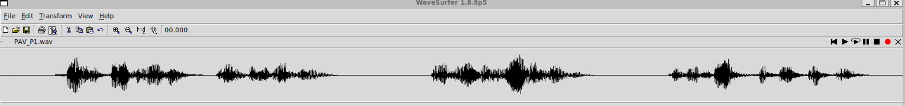

PAV - P2: detección de actividad vocal (VAD)
============================================

Esta práctica se distribuye a través del repositorio GitHub [Práctica 2](https://github.com/albino-pav/P2),
y una parte de su gestión se realizará mediante esta web de trabajo colaborativo.  Al contrario que Git,
GitHub se gestiona completamente desde un entorno gráfico bastante intuitivo. Además, está razonablemente
documentado, tanto internamente, mediante sus [Guías de GitHub](https://guides.github.com/), como
externamente, mediante infinidad de tutoriales, guías y vídeos disponibles gratuitamente en internet.


Inicialización del repositorio de la práctica.
----------------------------------------------

Para cargar los ficheros en su ordenador personal debe seguir los pasos siguientes:

*  Abra una cuenta GitHub para gestionar esta y el resto de prácticas del curso.
*  Cree un repositorio GitHub con el contenido inicial de la práctica (sólo debe hacerlo uno de los
  integrantes del grupo de laboratorio, cuya página GitHub actuará de repositorio central del grupo):
  -  Acceda la página de la [Práctica 2](https://github.com/albino-pav/P2).
  -  En la parte superior derecha encontrará el botón **`Fork`**. Apriételo y, después de unos segundos,
    se creará en su cuenta GitHub un proyecto con el mismo nombre (**P2**). Si ya tuviera uno con ese 
    nombre, se utilizará el nombre **P2-1**, y así sucesivamente.
*  Habilite al resto de miembros del grupo como *colaboradores* del proyecto; de este modo, podrán
  subir sus modificaciones al repositorio central:
  -  En la página principal del repositorio, en la pestaña **:gear:`Settings`**, escoja la opción 
    **Collaborators** y añada a su compañero de prácticas.
  -  Éste recibirá un email solicitándole confirmación. Una vez confirmado, tanto él como el
    propietario podrán gestionar el repositorio, por ejemplo: crear ramas en él o subir las
    modificaciones de su directorio local de trabajo al repositorio GitHub.
*  En la página principal del repositorio, localice el botón **Branch: master** y úselo para crear
  una rama nueva con los primeros apellidos de los integrantes del equipo de prácticas separados por
  guion (**fulano-mengano**).
*  Todos los miembros del grupo deben realizar su copia local en su ordenador personal.
  -  Copie la dirección de su copia del repositorio apretando en el botón **Clone or download**.
    Asegúrese de usar *Clone with HTTPS*.
  -  Abra una sesión de Bash en su ordenador personal y vaya al directorio **PAV**. Desde ahí, ejecute:

    ```.sh
    git clone dirección-del-fork-de-la-práctica
    ```

  -  Vaya al directorio de la práctica `cd P2`.

  -  Cambie a la rama **fulano-mengano** con la orden:

    ```.sh
    git checkout fulano-mengano
    ```

*  A partir de este momento, todos los miembros del grupo de prácticas pueden trabajar en su directorio
  local del modo habitual, usando el repositorio remoto en GitHub como repositorio central para el trabajo colaborativo
  de los distintos miembros del grupo de prácticas o como copia de seguridad.
  -  Puede *confirmar* versiones del proyecto en su directorio local con las órdenes siguientes:

    ```.sh
    git add .
    git commit -m "Mensaje del commit"
    ```

  -  Las versiones confirmadas, y sólo ellas, se almacenan en el repositorio y pueden ser accedidas en cualquier momento.

*  Para interactuar con el contenido remoto en GitHub es necesario que los cambios en el directorio local estén confirmados.

  -  Puede comprobar si el directorio está *limpio* (es decir, si la versión actual está confirmada) usando el comando
    `git status`.

  -  La versión actual del directorio local se sube al repositorio remoto con la orden:

    ```.sh
    git push
    ```

    *  Si el repositorio remoto contiene cambios no presentes en el directorio local, `git` puede negarse
      a subir el nuevo contenido.

      -  En ese caso, lo primero que deberemos hacer es incorporar los cambios presentes en el repositorio
        GitHub con la orden `git pull`.

      -  Es posible que, al hacer el `git pull` aparezcan *conflictos*; es decir, ficheros que se han modificado
        tanto en el directorio local como en el repositorio GitHub y que `git` no sabe cómo combinar.

      -  Los conflictos aparecen marcados con cadenas del estilo `>>>>`, `<<<<` y `====`. Los ficheros correspondientes
        deben ser editados para decidir qué versión preferimos conservar. Un editor avanzado, del estilo de Microsoft
        Visual Studio Code, puede resultar muy útil para localizar los conflictos y resolverlos.

      -  Tras resolver los conflictos, se ha de confirmar los cambios con `git commit` y ya estaremos en condiciones
        de subir la nueva versión a GitHub con el comando `git push`.


  -  Para bajar al directorio local el contenido del repositorio GitHub hay que ejecutar la orden:

    ```.sh
    git pull
    ```
  
    *  Si el repositorio local contiene cambios no presentes en el directorio remoto, `git` puede negarse a bajar
      el contenido de este último.

      -  La resolución de los posibles conflictos se realiza como se explica más arriba para
        la subida del contenido local con el comando `git push`.


*  Al final de la práctica, la rama **fulano-mengano** del repositorio GitHub servirá para remitir la
  práctica para su evaluación utilizando el mecanismo *pull request*.
  -  Vaya a la página principal de la copia del repositorio y asegúrese de estar en la rama
    **fulano-mengano**.
  -  Pulse en el botón **New pull request**, y siga las instrucciones de GitHub.


Entrega de la práctica.
-----------------------

Responda, en este mismo documento (README.md), los ejercicios indicados a continuación. Este documento es
un fichero de texto escrito con un formato denominado _**markdown**_. La principal característica de este
formato es que, manteniendo la legibilidad cuando se visualiza con herramientas en modo texto (`more`,
`less`, editores varios, ...), permite amplias posibilidades de visualización con formato en una amplia
gama de aplicaciones; muy notablemente, **GitHub**, **Doxygen** y **Facebook** (ciertamente, :eyes:).

En GitHub. cuando existe un fichero denominado README.md en el directorio raíz de un repositorio, se
interpreta y muestra al entrar en el repositorio.

Debe redactar las respuestas a los ejercicios usando Markdown. Puede encontrar información acerca de su
sintáxis en la página web [Sintaxis de Markdown](https://daringfireball.net/projects/markdown/syntax).
También puede consultar el documento adjunto [MARKDOWN.md](MARKDOWN.md), en el que se enumeran los
elementos más relevantes para completar la redacción de esta práctica.

Recuerde realizar el *pull request* una vez completada la práctica.

Ejercicios
----------

### Etiquetado manual de los segmentos de voz y silencio

- A continuación, se adjunta la captura de `wavesurfer` donde se aprecia la señal temporal (forma de onda) junto con su etiquetado manual de los segmentos de voz (V) y silencio (S):

  

- A la vista de la gráfica y de las pruebas realizadas, se extraen las siguientes conclusiones para los parámetros del detector:

  * **Incremento del nivel de potencia (dB):** Observamos que el ruido de fondo tiene una potencia muy baja y estable. Un incremento de aproximadamente **2.6 dB** (`llindar`) respecto al ruido inicial es un buen indicador de posible presencia de voz. Para evitar falsos positivos con ruidos impulsivos, consideramos que si el incremento supera un margen extra de **6.6 dB** (`marge_p`), podemos estar totalmente seguros de que se trata de voz.
  * **Duración mínima razonable:** Las pausas cortas (como las producidas por consonantes oclusivas) no deben considerarse silencios reales. Por ello, es prudente exigir que una señal de baja potencia se mantenga durante varias tramas (hemos parametrizado este valor a **24 tramas**) antes de consolidar el cambio de estado, o viceversa, para evitar interrupciones o arranques en falso.
  * **Evolución de la tasa de cruces por cero (ZCR):** Durante los silencios, la ZCR fluctúa de manera aleatoria debido al ruido de fondo. En los segmentos de voz, la ZCR se mantiene baja en vocales (sonoras) y aumenta drásticamente en las consonantes fricativas sordas (como la /s/ o la /f/). Integrar la ZCR junto a la potencia ayudaría a no confundir estas fricativas de baja energía con silencios.[cite: 1, 42, 47]


### Desarrollo del detector de actividad vocal

- Se ha implementado un detector de actividad vocal (VAD) en tiempo real basado en un **Autómata de Estados Finitos (FSA)** con decisión diferida e histéresis. La lógica programada funciona de la siguiente manera:
  1. **Inicialización (`ST_INIT`):** Se asume que el audio comienza en silencio y se estima la potencia de referencia del ruido (`potencia_soroll`).
  2. **Transiciones desde Silencio/Indefinido:** 
     - Si la potencia supera el umbral máximo (`potencia_soroll + llindar + marge_p`), se pasa directamente a estado de voz (`ST_VOICE`).
     - Si supera el umbral mínimo pero no el máximo, se entra en un estado de espera (`ST_UNDEF`). Si este nivel se mantiene durante un número predeterminado de tramas (`n_frames`), se consolida la transición a voz.
  3. **Transiciones desde Voz:** Si la potencia cae por debajo del umbral mínimo, el autómata vuelve automáticamente a estado de silencio (`ST_SILENCE`).
- **Discrepancias con el etiquetado manual:** Las mayores diferencias entre el etiquetado manual y el automático suelen concentrarse en las fronteras de las palabras (efecto *hangover*), ya que el autómata puede tardar unas tramas en confirmar la caída al silencio por las reverberaciones del habla. También puede haber discrepancias en fonemas aislados de muy baja energía donde la potencia no logra superar el umbral programado.
- **Evaluación sobre la base de datos `db.v4`:** Tras optimizar los parámetros del algoritmo, los resultados obtenidos con el script `vad_evaluation.pl` sobre el conjunto de test muestran un rendimiento excelente, alcanzando casi un 95% de puntuación-F TOTAL:

```text
**************** Summary ****************
Recall V:615.81/625.02 98.53%   Precision V:615.81/698.39 88.18%   F-score V (2)  : 96.27%
Recall S:317.88/400.47 79.38%   Precision S:317.88/327.09 97.19%   F-score S (1/2): 93.01%
===> TOTAL: 94.625%
```[cite: 1, 42]


### Trabajos de ampliación

Se han implementado con éxito las dos ampliaciones propuestas en la práctica:

#### 1. Cancelación del ruido en los segmentos de silencio

Se ha dotado al programa principal (`main_vad.c`) de la capacidad para limpiar el ruido de los audios. Cuando el usuario especifica un fichero `.wav` de salida mediante la opción `-w`, el programa escribe la señal original. Sin embargo, cada vez que el autómata confirma un segmento de silencio definitivo (`ST_SILENCE`), el programa retrocede dinámicamente en el puntero de escritura del fichero de audio (usando `sf_seek`) y sobrescribe la trama con ceros (`buffer_zeros`). Esto produce un archivo final donde los silencios son un cero absoluto, pero la voz se mantiene inalterada.[cite: 1, 43]

*(Nota: En la carpeta del proyecto se pueden generar y visualizar estos audios silenciados).*

#### 2. Gestión de las opciones del programa usando `docopt_c`

Se ha modificado la cabecera e integrado la librería `docopt_c` para exponer todos los parámetros de configuración del autómata directamente desde la línea de comandos, sin necesidad de recompilar el programa. Esto incluye el control sobre los umbrales de decisión, la duración temporal de las tramas, los márgenes de histéresis y el contador de *frames* diferidos. 

A continuación se muestra el mensaje de ayuda generado por el programa al ejecutar `./bin/vad -h`:

```text
VAD - Voice Activity Detector

Usage:
   vad [options] -i <input-wav> -o <output-vad> [-w <output-wav>]
   vad (-h | --help)
   vad --version

Options:
   -i FILE, --input-wav=FILE       WAVE file for voice activity detection
   -o FILE, --output-vad=FILE      Label file with the result of VAD
   -w FILE, --output-wav=FILE      WAVE file with silences cleared
   -l REAL, --llindar=REAL         llindar de decisió veu i silenci [default: 2.6]
   -t REAL, --frame-time=REAL      temps de cada trama en ms [default: 120]
   -m REAL, --marge-p=REAL         marge d'histèresi de potència pel canvi d'estat [default: 6.6]
   -n INTEGER, --n-frames=INTEGER  nombre de trames consecutives en estat INDEFINIT fins a decidir VEU [default: 24]
   -v, --verbose  Show debug information
   -h, --help     Show this screen
   --version      Show the version of the project
```[cite: 1, 44]


### Contribuciones adicionales y/o comentarios acerca de la práctica

Como aportación complementaria, hemos desarrollado un script en *bash* llamado `cardem-li.sh` para automatizar el cálculo de los mejores umbrales. Este script realiza un proceso de iteración sistemática (*grid search* o barrido), ejecutando la base de datos `db.v4` con valores de `llindar` que van desde 2.0 hasta 3.0 (en saltos de 0.05). A continuación, filtra estadísticamente las ejecuciones y las ordena por su puntuación TOTAL.

Esto nos ha permitido encontrar de manera rápida, automatizada y precisa la mejor combinación posible para el umbral de decisión, obteniendo así el `94.625%` final presentado en el apartado anterior.[cite: 1, 45, 46]